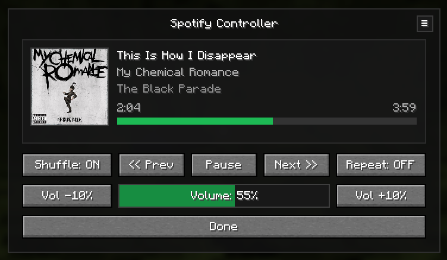
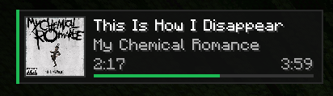

# Encore Music

A client-side Fabric and NeoForge mod that connects to the Spotify Web API via OAuth 2.0 PKCE, renders a draggable in-game **Now Playing** HUD widget, and lets you control Spotify playback through keybinds, an interactive controller UI, and client commands.

Because everything runs client-side, it works in singleplayer and on any multiplayer server without requiring server-side installation.

**[⬇ Download the latest release](https://github.com/theswag1/encore-music/releases/latest)**, then pick the jar for your mod loader and Minecraft version (see [Requirements](#requirements)).

<p align="center">
  
  <br>
  <em>Controller screen (<code>Z</code>)</em>
  <br><br>
  
  <br>
  <em>Now Playing HUD widget</em>
</p>

---

## Features

- **In-Game 3-Step First-Time Setup Wizard** (`O`, `Z`, `/encore setup`, or **Setup Guide** in Config)
  - Automatically opens the first time you press `O` or `Z` when no Spotify **Client ID** is configured, accompanied by a one-time yellow chat prompt when joining a world unconfigured.
  - Walks step-by-step through creating a Spotify Developer App (**Open Spotify Dashboard** button), registering the loopback Redirect URL (**Copy Redirect URL** button), and pasting/saving your **Client ID** (**Paste Clipboard** + **Save & Connect Spotify** buttons).
- **Full In-Game Controller Screen** (`Z`, `/encore`, or `/encore player`)
  - Displays `64x64` album art, marquee scrolling track / artist / album names, and a **clickable seek bar**.
  - Transport controls for **Shuffle**, **Previous**, **Play / Pause**, **Next**, and **Repeat** (`OFF` / `ALL` / `ONE`).
  - **Volume -10% / +10%** buttons plus an interactive **click-and-drag Volume bar**.
  - Hover the **☰** icon in the top-right corner to see an **Up Next** list of the next 10 tracks in your Spotify queue.
- **Draggable, Resizable & Customizable HUD Widget**
  - Displays the current track's album art, song title, artist name, elapsed/total time, accent end strip, and smoothly interpolated progress bar.
  - **Hover controls:** with chat, the inventory or any other in-world screen open, hover the widget to get clickable **Previous / Play-Pause / Next** buttons.
  - **Move / Resize HUD** in the Config screen (`O` or `/encore config`) opens an edit mode with **drag-and-drop positioning**, **scroll-wheel resizing (`50%`–`200%` in `5%` steps)** and a **Reset HUD** button.
  - **Customizable accent & playback bar color** via 8 color presets (`Green`, `Cyan`, `Blue`, `Purple`, `Pink`, `Red`, `Orange`, `White`) or a custom `#RRGGBB` hex input with a live color swatch.
  - **Compact mode:** a single `♪ Song — Artist` text line instead of the full card. The Config screen's **HUD Widget** button cycles `ON` (full card) → `COMPACT` → `OFF`.
  - Automatically scrolls long text (marquee), hides with `F1`, and toggles on/off via keybind (`\`), Config screen, or `/encore hud` (keeping the chosen full/compact style).
- **Configurable Keybinds**
  - Bindings for opening the Config/Controller UI, toggling the HUD, Play/Pause, Next Track, and Previous Track under **Options -> Controls -> Key Binds -> Encore Music**, showing clean action-bar feedback above the hotbar.
- **In-Game Configuration & OAuth 2.0 PKCE Auth**
  - Paste your Spotify Developer **Client ID** directly in-game (no Client Secret required).
  - One-click browser authorization with a local loopback callback (`http://127.0.0.1:8888/callback`), a **Copy Redirect URL** button, and automatic token refreshes stored locally in `config/encore_music_tokens.json` (kept separate from UI settings in `config/encore_music.json` so sharing your config never leaks your account tokens).
- **Async Spotify Web API Client**
  - Polls playback state and issues control requests asynchronously without blocking Minecraft's tick or render threads.
- **Update Checker**
  - Checks GitHub once per game session for a newer release and, when one exists, shows a one-time chat message with a clickable **[Download]** link to the release page. Disable it by setting `"checkForUpdates": false` in `config/encore_music.json`.

---

## Requirements

Each release has one jar per loader and Minecraft version, named `encore-music-<version>-<loader>-mc<minecraft>.jar` (for example `…-fabric-mc26.3.jar`):

| Minecraft | Jar ends in | Fabric | NeoForge |
| :--- | :--- | :--- | :--- |
| `26.3` | `-mc26.3.jar` | Loader `>=0.19.0`, Fabric API `0.166.2+26.3` | `26.3.x` |
| `26.2` | `-mc26.2.jar` | Loader `>=0.19.0`, Fabric API `0.161.0+26.2` | `26.2.x` |
| `26.1`–`26.1.2` | `-mc26.1.x.jar` | Loader `>=0.19.0`, Fabric API `0.155.3+26.1.2` | `26.1.x` |
| `1.21` / `1.21.1` | `-mc1.21.1.jar` | Loader `>=0.16.0`, Fabric API `0.116.18+1.21.1` | `21.0.x` / `21.1.x` |

- **Java:** `25` for `26.x`, or `21+` for `1.21` / `1.21.1`
- **Spotify Account:**
  - Viewing the currently playing track works on Free and Premium accounts.
  - Controlling playback (play/pause, skip, seek, shuffle, repeat, volume) requires **Spotify Premium** (enforced by Spotify's Web API) and an active Spotify playback device.

---

## Setup Guide

1. Place the matching jar for your mod loader and Minecraft version into your `.minecraft/mods/` folder (on Fabric, also include **Fabric API**) and launch Minecraft. *(On NeoForge, you can also open the setup wizard/config from the **Mods -> Config** button.)*
2. Join a world—if no Client ID is set yet, you'll see a prompt in chat. Press **`O`** (or **`Z`**, or run `/encore setup`) to open the **3-Step First-Time Setup Wizard** inside Minecraft:
   - **Step 1 — Create App:** Click **Open Spotify Dashboard**, sign in, click **Create app**, give it any name/description, and check **Web API**.
   - **Step 2 — Redirect URL:** Click **Copy Redirect URL** in-game to copy `http://127.0.0.1:8888/callback` *(use `127.0.0.1`, not `localhost`)*, paste it into **Redirect URIs**, click **Add**, accept the Terms of Service, and click **Save**.
   - **Step 3 — Connect:** Open **Settings** in your Spotify app, copy the **Client ID**, paste it into Minecraft (**Paste Clipboard**), and click **Save & Connect Spotify**.
3. Approve the permissions in the browser window that opens. Once redirected, click **Finish**—your HUD widget, keybinds, and controller screen (`Z`) are ready! *(You can reopen the wizard anytime via `/encore setup` or the **Setup Guide** button in Config.)*

---

## Keybinds & Commands

### Keybinds
| Default Key | Action | Category |
| :--- | :--- | :--- |
| `O` | Open Encore Music Settings | Encore Music |
| `Z` | Open Music Player | Encore Music |
| `\` | Toggle Now Playing HUD | Encore Music |
| `K` | Play / Pause Track | Encore Music |
| `]` | Next Track | Encore Music |
| `[` | Previous Track | Encore Music |

### Client Commands
| Command | Description |
| :--- | :--- |
| `/encore` or `/encore player` | Open the Encore Music player screen (or Setup Wizard if Client ID is unset) |
| `/encore config` | Open the Config screen (or Setup Wizard if Client ID is unset) |
| `/encore setup` | Open the interactive 3-step First-Time Setup Wizard |
| `/encore clientid <id>` | Set and save your Spotify Client ID from chat |
| `/encore login` | Start the browser OAuth PKCE login flow |
| `/encore status` | Print connection state and currently playing track in chat |
| `/encore hud` | Toggle the in-game Now Playing HUD widget on/off |
| `/encore play` | Resume playback on your active Spotify device |
| `/encore pause` | Pause playback on your active Spotify device |
| `/encore next` | Skip to the next track |
| `/encore prev` | Return to the previous track |
| `/encore volume <0-100>` | Set playback volume percentage |
| `/encore shuffle` | Toggle shuffle mode on/off |
| `/encore repeat` | Cycle repeat mode (`OFF` -> `ALL` -> `ONE`) |
| `/encore share` | Post the current song and its `open.spotify.com` link to chat (the link is clickable on servers that turn chat URLs into links, such as NeoForge) |

---

## Building from Source

Requires **JDK 25** (and **JDK 21** toolchain installed for NeoForge `1.21.1`).

```bash
# Fabric (Minecraft 26.3 / 26.2 / 26.1.x / 1.21.1)
./gradlew build
./gradlew build -Pmc262
./gradlew build -Pmc261
./gradlew build -Pmc121

# NeoForge (Minecraft 26.3 / 26.2 / 26.1.x / 1.21.1)
./gradlew build -Pneoforge
./gradlew build -Pneoforge -Pmc262
./gradlew build -Pneoforge -Pmc261
./gradlew build -Pneoforge -Pmc121
```

*(On Windows PowerShell, use `.\gradlew.bat` instead of `./gradlew`.)*

The compiled jars are output to `build/libs/` as `encore-music-<version>-<loader>-mc<minecraft>.jar`, where `<version>` is `mod_version` from `gradle.properties`.
